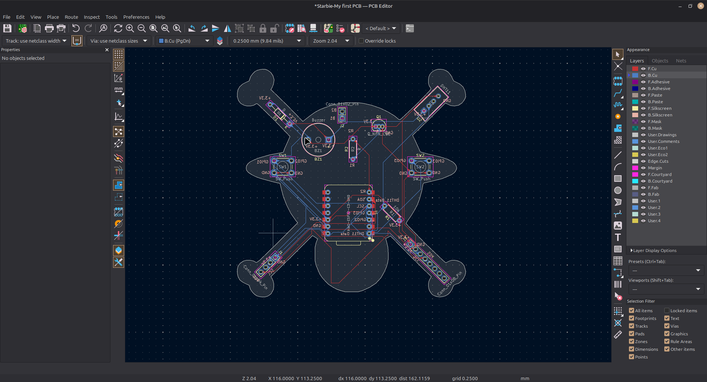
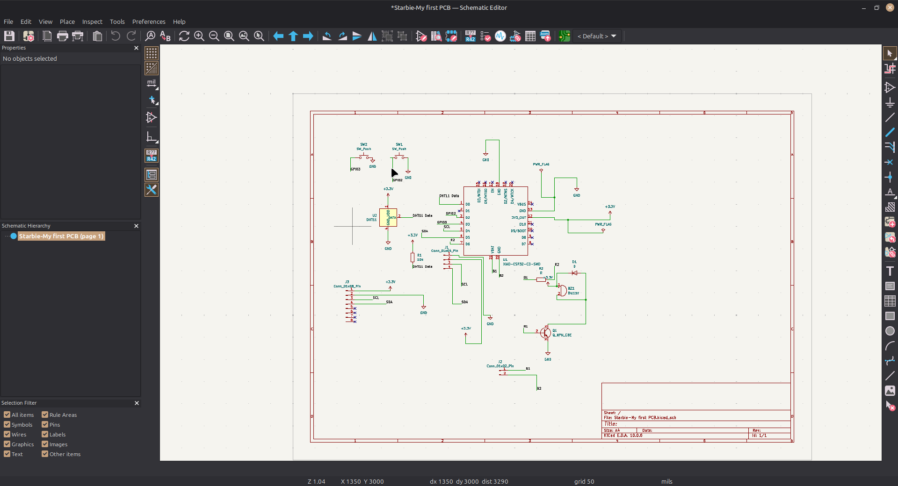
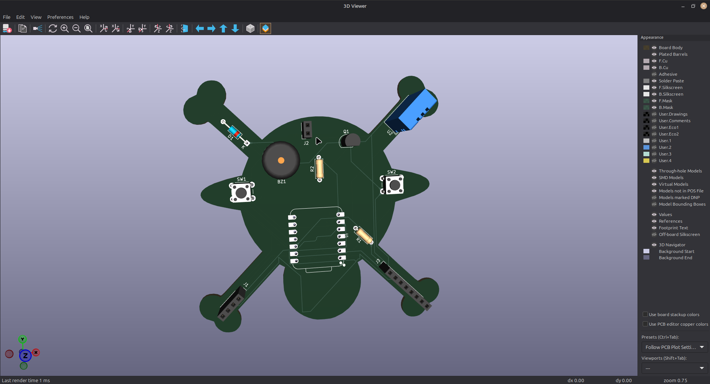
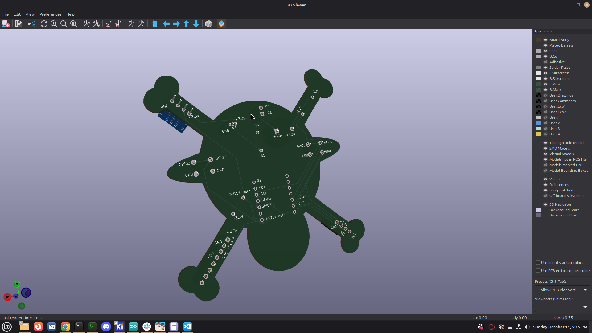

# Starbie — Straw Hat Edition

A custom pirate-themed interactive virtual pet console and environmental monitor powered by the Seeed Studio XIAO ESP32-C3. 

Built for Week 1 of the Hack Club Half-Life program, this board features a custom hand-routed crossbones PCB outline, physical motion interaction, environmental tracking, audio feedback, and a custom Straw Hat Luffy sprite.

---
## Images

---

## Hardware Features

* **Microcontroller:** Seeed Studio XIAO ESP32-C3 (160 MHz 32-bit RISC-V core).
* **Display Interface:** 4-pin female header socket driving a 0.96" I2C SSD1306 monochrome OLED display.
* **Motion Tracking:** 8-pin female header socket interfacing an MPU-6050 6-axis accelerometer/gyroscope for tilt menu navigation and shake reactions.
* **Environmental Sensing:** Dedicated single-wire interface with pull-up resistor for a DHT11 temperature and humidity sensor.
* **Audio Circuitry:** Inductive buzzer switched via an NPN transistor (TO-92) with a 1N4148 flyback diode to absorb reverse voltage spikes.
* **User Controls:** Two tactile momentary pushbuttons for radial menu navigation and HUD toggling.
* **Form Factor:** Hand-routed custom crossbones PCB contour passing Design Rule Check (DRC) with 0 errors and 0 unrouted nets.

---

## Hardware Pinout

| Function / Component | XIAO Pin Label | ESP32-C3 GPIO | Notes |
| :--- | :--- | :--- | :--- |
| **DHT11 Data** | D0 | GPIO 2 | 10kΩ pull-up to +3.3V |
| **Button 1 (Menu)** | D2 | GPIO 4 | Active-Low (Internal Pull-Up) |
| **Button 2 (Stats)** | D3 | GPIO 5 | Active-Low (Internal Pull-Up) |
| **I2C SDA** | D4 | GPIO 6 | Shared by OLED and MPU-6050 |
| **I2C SCL** | D5 | GPIO 7 | Shared by OLED and MPU-6050 |
| **Buzzer Driver** | D6 | GPIO 21 | Switches NPN base via 1kΩ resistor |

---

## Bill of Materials (BOM)

| Reference | Component | Value / Spec | Package / Footprint | Qty | Function |
| :--- | :--- | :--- | :--- | :--- | :--- |
| **U1** | XIAO ESP32-C3 | Microcontroller Module | SMD / Socket | 1 | Main Processor |
| **U2** | DHT11 | Temp & Humidity Sensor | 4-Pin / 3-Pin TH | 1 | Ambient Room Sensor |
| **BZ1** | Electromagnetic Buzzer | 12x9.5 mm | Through-Hole | 1 | Sound Feedback |
| **Q1** | NPN Transistor | 2N3904 / S8050 | TO-92 | 1 | Buzzer Low-Side Switch |
| **D1** | Switching Diode | 1N4148 | DO-35 Axial | 1 | Flyback Inductive Protection |
| **SW1, SW2** | Tactile Switch | 6x6 mm Momentary | 6mm Tactile TH | 2 | Navigation & Stats Toggle |
| **R1** | Resistor | 10kΩ | Axial Through-Hole | 1 | DHT11 Data Pull-Up |
| **R2** | Resistor | 1kΩ | Axial Through-Hole | 1 | Transistor Base Resistor |
| **J1** | Pin Header Socket | 1x04 (2.54mm Pitch) | Female Header | 1 | 0.96" OLED Mount |
| **J3** | Pin Header Socket | 1x08 (2.54mm Pitch) | Female Header | 1 | MPU-6050 IMU Mount |
| **J2** | Pin Header | 1x02 (2.54mm Pitch) | Pin Header | 1 | Battery / Power Input |

### Hack Club Half-Life Grant Procurement BOM (USD)
*All parts strictly budgeted under Hack Club Half-Life Tier 1 Grant limit ($30.00 USD).*

| Part | Qty | Unit | Total | Vendor | Reference / Notes |
| :--- | :---: | :---: | :---: | :--- | :--- |
| **Seeed Studio XIAO ESP32-C3** | 1 | $8.97 | $8.97 | Robu.in | U1 (Main Controller) |
| **0.96 inch Yellow-Blue OLED Display Module** | 1 | $2.14 | $2.14 | Robu.in | J1 Mount (SSD1306 Display) |
| **DHT11 Temperature & Humidity Sensor Module** | 1 | $0.71 | $0.71 | Robu.in | U2 (Environment Sensor) |
| **SmartElex MPU-6050 6-Axis IMU Module** | 1 | $5.32 | $5.32 | Robu.in | J3 Mount (Motion Sensor) |
| **YMD12095 5V Active Buzzer (12x9.5mm)** | 1 | $0.29 | $0.29 | Robu.in | BZ1 (Audio Output) |
| **Tactile Push Button Switch 6x6x5 (Pack of 10)** | 1 | $0.23 | $0.23 | Robu.in | SW1, SW2 (Inputs) |
| **CFR25 10k Ohm Axial Resistors (Pack of 7)** | 7 | $0.02 | $0.14 | Robu.in | R1 (Pull-up Resistor) |
| **MF25 1k Ohm Axial Resistors (Pack of 3)** | 3 | $0.05 | $0.15 | Robu.in | R2 (Base Resistor) |
| **2N2222A NPN Transistor TO-92 (Pack of 4)** | 4 | $0.04 | $0.15 | Robu.in | Q1 (Buzzer Switch) |
| **1N5819 Schottky Diode DO-41 (Pack of 2)** | 2 | $0.07 | $0.14 | Robu.in | D1 (Flyback Protection) |
| **1x40 Pin 2.54mm Male Berg Strip Connector** | 2 | $0.10 | $0.19 | Robu.in | J2 Header & Pins |
| **1x40 Pin 2.54mm Straight Long Female Strip Socket** | 1 | $1.17 | $1.17 | Robu.in | J1, J3 Female Sockets |
| **Custom Starbie PCB Fabrication (5 pcs)** | 1 | $0.00 | $0.00 | JLCPCB | 5 Custom PCBs ($4 coupon applied) |
| **Tax & Shipping (JLCPCB to India)** | 1 | $9.75 | $9.75 | JLCPCB | Shipping for 5 custom boards |
| **TOTAL ORDER COST** | | | **$29.34** | | **Tier 1 Budget: $29.34 of $30.00** ✅ |

---

## Firmware Setup

1. Open `Firmware/Starbie/Starbie.ino` in the Arduino IDE.
2. Ensure the `esp32 by Espressif Systems` board package is installed.
3. Select **XIAO_ESP32C3** under **Tools → Board → esp32**.
4. Install required libraries via Library Manager:
   * `Adafruit GFX Library`
   * `Adafruit SSD1306`
   * `Adafruit MPU6050`
   * `DHT sensor library`
5. Connect your board via USB-C and hit **Upload**.

---
## How I made It !
First of all i am a beginner who is doing his first hardware project and first project without the use of AI (exluding writng C++ in the arduino IDE it is well under the 30% ai limit)

This is the first time i am writing a README.md !! I used a little it help of ai here too :C

I was seriously like oh i could even do all this !! when i first opened the kicad for half life

Half Life is my first ysws and first project in which use of ai was minimal but still it was hard for me !!

But it was really fun too !!
I started this week late just on wed and that also cuz of schools etc i was busy right now too!!

KiCAD is now really easy for me it doesn't feel like a new world now !!:D 

But i had many dificuties too very much so this time instead of vibe coding i did everything myself just took help of the ai by asking questions like "How to do this ?" etc but i did the entire designing part myself and also i was really scarded like just how to write a README !!!!!!!!

But now it feels easy !!

But i am keeping the AI text as i am like mid in presentation so if there is any problem like i can't use AI in the readme please just infrom me i will write everything myself!

And also i am able to explain the entire project myself !

---
# Most Boring parts

What i found most boring was adding silkscreen !!
Other than it i enjoyed everything most of ig

And solving the errors in the PCB design was the most frustating part !!! that 64nm error i talked about in my journal !!

---
# Most Fun part
Most fun part as PCB routing and adding the edge.cuts as the straw hats !!!!!!!!!!

After that i enjoyed the schemetic too and i generally enjoyed the debugging the KiCad errors too !

---
## At last I want to thanks the hc ysws half life organizers for organizing such a great ysws and giving me the opportinity to learn !!